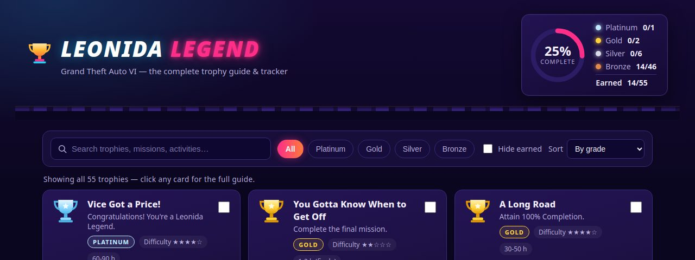

# Leonida Legend — GTA VI Trophy Guide

[](https://make.fun/bounty/gta6-trophy-guide-01)
[](https://make.fun/bounty/gta6-trophy-guide-01/leaderboard)
[](https://make.fun/bounty/gta6-trophy-guide-01)

Entry for the make.fun bounty **Build the best GTA 6 trophy guide** (`gta6-trophy-guide-01`).



## What it is

**Leonida Legend** is a complete trophy guide and tracker for Grand Theft Auto VI (PlayStation 5).
Every one of the 55 official trophies gets a full step-by-step guide written for this entry —
what to do, where and when, pro tips, missable warnings, a difficulty rating and a time estimate.
The app wraps those guides in a Vice City neon tracker:

- **Progress dashboard** — a completion ring plus earned counts per grade (platinum / gold / silver / bronze).
- **Search** across trophy names, descriptions and guide text.
- **Grade filter chips** and a **hide-earned** toggle.
- **Sorting** by grade, by name, unearned-first, or trophy-list order.
- **Detail view** for every trophy with the full guide, pro tip, missable note, difficulty stars and time estimate.
- **Checkboxes** to tick trophies off as you earn them; the completion percentage updates live.

Everything runs offline from plain static files — no build step, no network requests.

## Run it

```bash
node serve.ts          # serves app/ on http://localhost:8080
node main.ts           # writes app/, screenshots/ and dossier.json to /output
```

Outside the grader's container, `MAKEFUN_OUTPUT_DIR` stands in for `/output`:

```bash
mkdir -p out && MAKEFUN_OUTPUT_DIR=out node main.ts
```

## Layout

- `app/index.html`, `app/app.js`, `app/style.css` — the guide app (hand-written, no libraries).
- `app/data/trophies.json` — the 55 official trophies with enriched guides.
- `screenshots/` — the four judge screenshots.
- `main.ts` + `vendor/makefun-frontend.ts` — the make.fun entry plumbing.

---

Built for [make.fun](https://make.fun/r/3v2j7j85) — referral code **3v2j7j85**.
